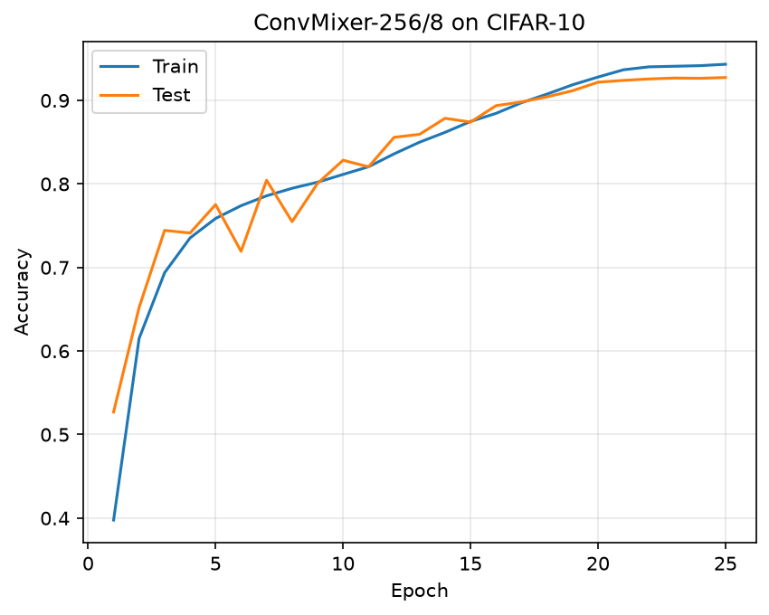
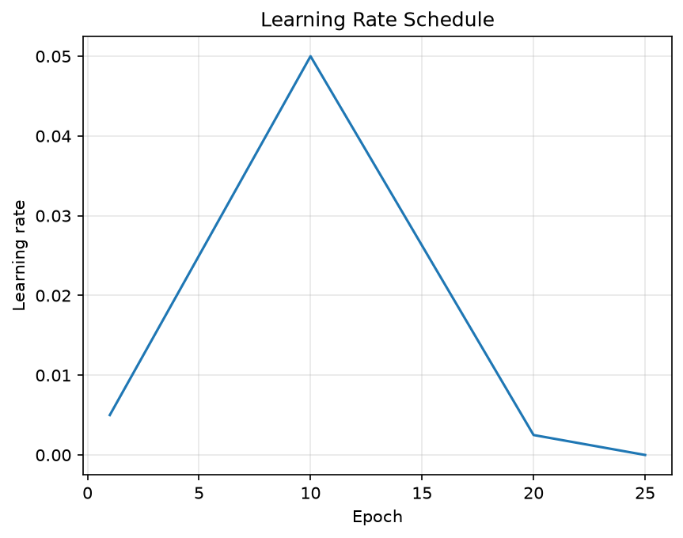

# B8: ConvMixer Reproduction

Reproduction and experimental analysis of **Patches Are All You Need?** on CIFAR-10. We aim to reproduce the original ConvMixer results, compare the model with ResNet and ViT, and investigate the effects of data augmentation and patch size
DL, HSE, 2026.

## 1. Project Links
- **Paper:** [Patches Are All You Need?](https://arxiv.org/abs/2201.09792)
- **Original implementation:** [locuslab/convmixer](https://github.com/locuslab/convmixer)
- **CIFAR-10 implementation:** [locuslab/convmixer-cifar10](https://github.com/locuslab/convmixer-cifar10)
- **Dataset:** CIFAR-10
- **GitHub repository:** [SSHwizard07/dl-b8-convmixer](https://github.com/SSHwizard07/dl-b8-convmixer)
- **Pre-registration PDF:** TODO
- **Pre-registration Pull Request:** TODO
- **Original baseline logs:** TODO
- **Experiment tracking:** TODO

## 2. Installation

### TODO

## 3. Original Baseline (R0 / As is)

ConvMixer-256/8, CIFAR-10, 25 epochs, NVIDIA T4 

Train accuracy - 94.33%  | Test accuracy - 92.74%  
Reference accuracy - 92.60%  | Training time  ~ 21 min 

<table>
  <tr>
    <th align="center">Train & Test Accuracy</th>
    <th align="center">Learning Rate Schedule</th>
  </tr>
  <tr>
    <td width="50%">
      
    </td>
    <td width="50%">
      
    </td>
  </tr>
</table>

## 4. Team

| Member                    | Responsibilities |
|---------------------------|------------------|
| Цивлин А (SSHwizard07)    | TODO             |
| Широкая А (annashirokaia) | TODO             |